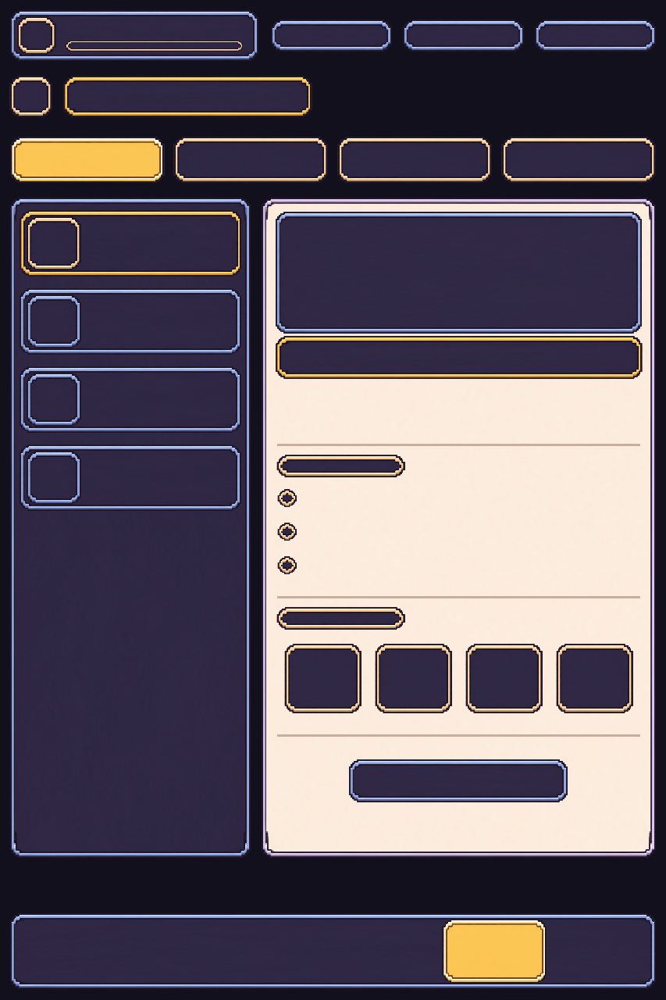

# Tư liệu bố cục màn Nhiệm vụ

Bản concept lưu trữ của màn Nhiệm vụ đã được gỡ khỏi app.

[Mở ảnh khung 853 × 1280](quest-layout.png)

Ảnh là bản thiết kế dọc theo tỷ lệ **853:1280** của ảnh mẫu Nhiệm vụ.
Chỉ lấy vị trí, tỷ lệ và vai trò các vùng. Màu và viền của ảnh lấy từ
[concept UI PixelRPG](reusable-ui-concept.md): nền tối, khung tím than
viền bậc, vàng cho lựa chọn và nền kem cho nội dung dài.

| Vùng | Bố cục trên canvas (px) | Khung dùng lại |
| --- | --- | --- |
| HUD | Trên cùng: hồ sơ bên trái, ba khay tài nguyên bên phải | `cool` và `cream` |
| Đầu trang | Nút quay lại và bảng tiêu đề tại y = 96 | `cream` và `gold` |
| Tab | Bốn ô ngang tại y = 174 | `cream`; ô chọn dùng `selected` |
| Danh sách chương | x = 12, y = 252, rộng 310, cao 848; bốn hàng minh họa | `cool`; hàng chọn dùng viền `gold` |
| Chi tiết | x = 334, y = 252, rộng 507, cao 848; từ trên xuống gồm vùng banner, tiêu đề, mô tả, mục tiêu, bốn ô thưởng và nút trạng thái | `paper` cho thân; `cool`, `gold` và `cream` cho khung con |
| Điều hướng | x = 12, y = 1168, rộng 829, cao 100; vùng chọn ở ô thứ năm trong sáu ô | Khay `cool`, ô chọn `selected` |

Runtime lấy Home làm chuẩn theo [Quy chuẩn UI](ui-guidelines.md): cùng mật độ viền và neo navigation; tiêu đề cố định, nội dung cuộn trong cửa sổ giữa.
Chương dùng lưới ô đều; tab tự xuống hàng;
danh sách chương nằm trên chi tiết khi hẹp/chữ lớn, chia hai cột 1:2 khi đủ
600 × hệ số chữ dp. Các số đo bên dưới mô tả bản concept.

Hai cột trong ảnh chiếm khoảng **38:62**, cách nhau 12 px. Các số đo dùng để
dựng ảnh tham chiếu, không phải kích thước Flutter cố định. Khi triển khai,
chừa vùng an toàn và kiểm tra chỗ cho chữ, nội dung cuộn và vùng chạm
trên màn hình hẹp.

Ảnh được ghép từ [atlas khung tham chiếu](../../assets/ui/README.md) bằng
9-slice: góc 56 px trong nguồn được thu còn 14 px trên canvas (giảm thêm
đối với ô nhỏ), chỉ kéo phần cạnh và tâm bằng nearest-neighbor. Chữ, icon,
tranh, trạng thái nhiệm vụ và dữ liệu thưởng sẽ là các lớp riêng.
